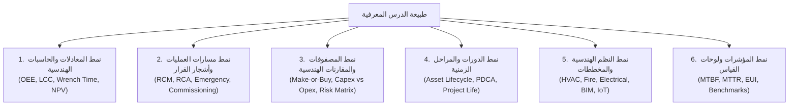

# دستور ومعيار إنتاج فيديوهات أكاديمية GridFix (الإطار الشامل لكافة الدروس)
# GridFix Academy Universal YouTube Video Production Framework

هذا المستند هو **الدستور الشامل والمعيار المرجعي المُلزم** لإنتاج كافة فيديوهات منصة **GridFix Academy** عبر مساراتها الثلاثة:
* **CFM (38 درساً)**: إدارة وتشغيل المنشآت والعقارات والسلامة والمشاريع (IFMA).
* **CMRP (21 درساً)**: هندسة الصيانة والموثوقية وإدارة العمل وإدارة الأصول (SMRP).
* **CAMA (17 درساً)**: تقييم وإدارة الأصول المؤسسية والحوكمة وتكلفة دورة الحياة (ISO 55000 / WPiAM).

> **الهدف الاستراتيجي:** بناء محرك إنتاج يجعل من **كل درس تجربة بصرية فريدة وأصيلة (Unique Visual Fingerprint)** تناسب طبيعة مادته الهندسية الخاصة، مع الحفاظ على الهوية المؤسسية الراقية والامتثال التام لشروط برنامج شركاء يوتيوب (YPP) لتحقيق أعلى عائد إعلاني.

---

## 🌟 المبدأ الحاكم الأسمى: لا تبخل ولا تختصر — الإتقان التعليمي الشامل والتأنيس الكامل (Deep Mastery & Full Humanization Mandate)

هذا هو **القانون الذهبي الأول والأعلى شأناً في كافة مراحل الإنتاج**، ومخالفته تبطل اعتماد الفيديو فوراً:

1. **حظر البخل أو الاختصار المخل (Zero Skimping):**
   * **ممنوع تماماً القفز فوق التفاصيل الهندسية:** الهدف الأسمى ليس سرعة إنهاء الفيديو، بل أن يخرج الدارس من الدرس وهو فاهم ومستوعب لكل جزئية، معادلة، منحنى، وسيناريو هندسي استيعاباً عميقاً يؤهله لتطبيقه عملياً في المنشأة أو المصنع والتفوق في الامتحان الدولي.
   * **شرح كل عنصر بذاته وتفصيله:** إذا كان الدرس يتناول 6 منحنيات أعطال، يُفرد لكل منحنى وقته التام، نسبته الإحصائية، ظروف تشكله، وأمثلته الميكانيكية والكهربائية الحية. إذا كان الدرس يطرح معادلة، تُفكك رموزها وحدودها حداً حداً ويُشرح أثر كل متغير على أرض الواقع.
   * **العمق لا يعني الحشو:** الشرح المفصل يعني الوضوح والتمثيل وضرب الأمثلة الواقعية وتفكيك الصعوبات، وليس التكرار اللفظي غير المفيد.

2. **تسخير كامل الإمكانيات البصرية لتحقيق الفهم (Visual Arsenal Unleashed):**
   * لا تترك أي فكرة هندسية مجرد كلام نظري إذا كان بالإمكان تجسيدها بصرياً.
   * استخدم كافة أدوات الإخراج: المعادلات المفككة بالألوان، الرسوم المتجهية للأنظمة (Blueprints)، مسارات التدفق المضيئة، العدادات الرقمية للـ KPIs، مقارنات الشاشات المنقسمة، ومخططات دورة الحياة.
   * تزامن الدخول البصري التدريجي (Progressive Reveal) مع نطق كل نقطة على حدة، ليظل انتباه المشاهد مربوطاً 100% بالنقطة التي تُشرح الآن دون تشتيت.

3. **تسخير كامل الإمكانيات الصوتية الإنسانية (Full Humanized Peer-to-Peer Audio):**
   * كسر الجمود التلقيني تماماً: الصوت ليس روبوتاً يقرأ كتاباً، بل **مهندس استشاري وخبير مصري ودود** ينقل عصارة خبرته الميدانية لزميل مهنة في جلسة نقاش هندسية ثرية.
   * توظيف الوقفات الطبيعية العفوية للتفكير والتركيز قبل الكشف عن الحلول.
   * طرح التساؤلات المشتركة: *"طب تفتكر ليه ده بيحصل؟"*، *"تعال نتخيل السيناريو ده سوا في مصنع شغال..."*، *"ركز معايا في الحتة دي لأنها مربط الفرس!"*.
   * ضرب الأمثلة الحية من بيئة العمل الواقعية في مصر والعالم العربي (محطات التبريد، طلمبات التغذية، لوحات التوزيع، خطوط الإنتاج).

4. **الزمن الطبيعي للاستيعاب (True Mastery Duration):**
   * تتراوح مدة الشرح الوافي للدرس عادة بين **8 إلى 14 دقيقة** (أو أكثر إذا تطلب الموضوع تشريحاً أعمق). أي محاولة لضغط الدرس في 2-3 دقائق سطحية تُعد مخالفة صريحة لدستور المنصة.

---

## 🧭 الباب الأول: نظام "البصمة الفريدة" لكل درس (The Unique Lesson Fingerprint)

ممنوع استخدام قالب موحد مكرر لكل الدروس! كل درس من الدروس الـ 76 يمتلك طبيعة معرفية مختلفة، وبالتالي يجب أن تنعكس مادته في **نمط الإخراج البصري المناسب له**:

---

## 🎨 الباب الثاني: مصفوفة الأنماط البصرية الستة (The 6 Visual Archetypes)

يحدد المطور أو الوكيل (Agent) **النمط البصري الأساسي** للدرس بالرجوع إلى ملف `src/content/lessons/{course}/{lesson-id}.mdx`:

### النمط 1: دروس المعادلات والحاسبات الهندسية (Calculation & Formula Engines)
* **أمثلة الدروس:** درس OEE، درس تكلفة دورة الحياة LCC، درس وقت استخدام المفتاح Wrench Time، درس صافي القيمة الحالية للعقارات Lease NPV، معادلة الاحتمال الشرطي $\lambda(t)$.
* **العناصر البصرية الحصرية لهذا النمط:**
  * **المعادلة المفككة لونياً (Color-Coded Formula):** تلوين كل حد بلون مستقل (أخضر للناتج، أزرق للمتغيرات، أحمر للثوابت) مع ظهور بطاقات تعريفية لكل رمز عند نطقه.
  * **حاسبة الشاشة التفاعلية (Live On-Screen Calculator):** لوحة تظهر إدخال أرقام تجريبية من واقع مصنع أو مبنى حقيقي، وملاحظة كيف يتغير الناتج اللحظي.
  * **شريط النطاقات المعيارية (Benchmark Bands):** شريط يعرض مؤشر القيمة الناتجة (مثلاً: OEE عالمي 85% كـ World Class، وأقل من 65% كـ Danger Zone).

### النمط 2: دروس مسارات العمليات وأشجار القرار (Process Flows & Decision Trees)
* **أمثلة الدروس:** شجرة قرارات RCM، مسار خطة الطوارئ والإخلاء، تحقيق جذور الأعطال RCA (5 Whys / Fishbone)، دورة استلام وتسليم المنشأة Commissioning.
* **العناصر البصرية الحصرية لهذا النمط:**
  * **المخطط الانسيابي المتشعب (Interactive Branching Tree):** تظهر العقدة الأولى (السؤال الأول: "هل العطل واضح للمشغل؟").
  * **المسار المضيء (Glowing Branching Path):** عند اختيار "نعم" أو "لا"، يضيء المسار المختار باللون الأخضر أو الأحمر مع انتقال الكاميرا نحوه وخفوت المسار البديل.
  * **بوابات التحقق (Checkmark Gates):** شارات إنجاز تظهر تباعاً عند اكتمال كل مرحلة في العملية الصناعية.

### النمط 3: دروس المقارنات والمصفوفات والمفاضلات (Comparative Matrices & Trade-offs)
* **أمثلة الدروس:** مصفوفة الصيانة الذاتية مقابل التعاقد الخارجي (Make-or-Buy)، الصيانة بالزمن مقابل المشروطة بالحالة، مصفوفة تقييم المخاطر 5x5، الشراء مقابل الاستئجار (Lease vs Buy).
* **العناصر البصرية الحصرية لهذا النمط:**
  * **الشاشات المنقسمة التفاعلية (Interactive Split-Screen):** كرتان عملاقان متجاوران بتصميم زجاجي عالي التباين؛ الأول باللون الأحمر/البرتقالي للخيار التقليدي، والثاني بالأخضر/الأزرق للخيار الأمثل.
  * **المصفوفة الرباعية (2x2 Matrix HUD):** تقسيم الشاشة لـ 4 أرباع (مثل: احتمالية العطل مقابل أثر الفشل)، مع وميض المربع الذي يُشرح الآن وتظليل المربعات الثلاثة الأخرى.
  * **ميزان المفاضلة (Balance Scale Indicator):** رسم بياني ديناميكي يوضح كفة التكاليف مقابل كفة المخاطر.

### النمط 4: دروس الدورات والمراحل الزمنية (Lifecycles & Timelines)
* **أمثلة الدروس:** دورة حياة الأصل وفق ISO 55000 (من التخطيط حتى التكهين والتخريد)، دورة التحسين المستمر PDCA، دورة الميزانية التقديرية، مراحل مشروع المنشأة.
* **العناصر البصرية الحصرية لهذا النمط:**
  * **المدار الدائري التفاعلي (Circular Orbital Stage):** حلقة دائرية مقسمة لقطاعات هندسية أنيقة؛ يضيء القطاع النشط بتوهج مشع ويدور المؤشر نحوه مع شرح الصوت.
  * **المخطط الزمني التدريجي (Stepped Timeline):** خط زمني أفقي مضيء تظهر محطاته بالتتابع الزمني كل 10-15 ثانية، مع إظهار معالم الإنجاز (Milestones).

### النمط 5: دروس النظم الهندسية والمخططات (Schematics & Physical Systems)
* **أمثلة الدروس:** أنظمة التكييف المركزي HVAC ومسارات التبريد، لوحات التوزيع الكهربائي والمولدات الاحتياطية، شبكات مكافحة الحريق والرشاشات، أنظمة المباني الذكية BMS و CAFM و IoT.
* **العناصر البصرية الحصرية لهذا النمط:**
  * **المخطط الهندسي التوضيحي (Technical Vector Blueprint):** رسم تخطيطي متجهي لمكونات النظام (مثل: Chiller, AHU, Cooling Tower).
  * **أسهم السريان المتحركة (Dynamic Flow Arrows):** أسهم تعبر عن حركة الهواء أو سريان المياه المبردة أو الإشارات الرقمية بألوان معبرة (أزرق للبارد، أحمر للحار، أصفر للكهرباء).
  * **المقاطع الداخلية التكبيرية (Cutaway Zoom Calls):** إبراز مقطع داخلي دقيق للمكون الذي يُشرح لمنح المشاهد فهماً فيزيائياً ملموساً.

### النمط 6: دروس المؤشرات والبيانات ولوحات التحكم (KPI Dashboards & Analytics)
* **أمثلة الدروس:** مؤشرات الاعتمادية (MTBF, MTTR, MTTF)، كثافة استهلاك الطاقة EUI، استغلال المساحات Space Utilization، معدلات الحوادث OSHA TRIR.
* **العناصر البصرية الحصرية لهذا النمط:**
  * **عدادات القياس التفاعلية (Digital Gauge Meters):** عداد نصف دائري يتحرك مؤشره نحو الرقم المستهدف مع تلوين مناطق الخطر بالأحمر والمناطق المثالية بالأخضر.
  * **مقارنات المعايير المرجعية (Benchmark Scorecards):** بطاقات تعرض معدل أداء المنشأة الحقيقي مقارنة بأفضل الممارسات العالمية في الصناعة (Best-in-Class).

---

## 🎨 الباب الثالث: الهوية اللونية المتغيرة حسب الكورس والمحطة (Dynamic Station Palette)

لكسر النمطية وتفادي رتابة تكرار نفس اللون في كل الفيديوهات، يعتمد كل كورس ومحطة **لوناً مميزاً (Station Theme Accent)** مستوحى من طبيعة التخصص:

| الكورس / المحطة | اللون المميز الأساسي | الدلالة الهندسية |
| :--- | :--- | :--- |
| **CMRP - الموثوقية والمعدات** | أزرق سيان كهرومغناطيسي `#38bdf8` | دقة الآلات والاهتزازات والتحليل الرياضي |
| **CMRP - الصيانة وإدارة العمل** | أخضر زمردي صناعي `#10b981` | استقرار خطوط الإنتاج والتشغيل المستمر |
| **CFM - التشغيل والأنظمة (O&M)** | أزرق تقني عميق `#0284c7` | شبكات المباني والـ HVAC والكهرباء |
| **CFM - العقارات والمساحات (Real Estate)** | بنفسجي ملكي هادئ `#8b5cf6` | إدارة الأصول العقارية والمحافظ والمساحات |
| **CFM - الماليات والميزانيات (Finance)** | عنبري ذهبي `#f59e0b` | الميزانيات الرأسمالية والتشغيلية و LCC |
| **CFM - السلامة والبيئة (HSE & Risk)** | أحمر برتقالي ناري `#f97316` | خطط الطوارئ، تقييم المخاطر، والـ OSHA |
| **CFM - الاستدامة والمباني الخضراء (LEED)** | أخضر عشبي بيئي `#22c55e` | كفاءة الطاقة، المياه، وإدارة المخلفات |
| **CAMA - حوكمة وإدارة الأصول (ISO 55000)** | أزرق بحري نيلي `#6366f1` | دورة حياة الأصول والسياسات المؤسسية |

* **القاعدة المشتركة:** تظل الخلفية الداكنة الفخمة `radial-gradient(circle at 50% 25%, #1e293b 0%, #0f172a 60%, #020617 100%)` وشبكة الـ CAD Blueprint موحدة لجميع الدروس لضمان ترسيخ هوية **GridFix Academy**.

---

## 🎙️ الباب الرابع: الإلقاء الصوتي وتوليد السيناريو الودّي (Voice & Scripting)

### 1. معادلة الافتتاحية الحوارية (The 15-Second Hook Formula)
ممنوع البدايات الروتينية الجافة! كل درس يبدأ بمعادلة الـ 15 ثانية:
1. **طرح السؤال الحائر أو المعضلة الشائعة من بيئة العمل:**  
   *"خليني أسألك سؤال بصراحة يا باشمهندس... لو جالك تقرير بيقول إن صيانة كذا بتكلف كذا، هل أول خطوة تاخدها هي قطع الميزانية؟"*
2. **بدء المفاجأة أو نسف الأسطورة الشائعة:**  
   *"زمان كانت أغلب الشركات بتعمل كذا، بس الحقيقة اللي أثبتتها الأرقام كانت صدمة حقيقية!"*
3. **الدخول في صلب الموضوع مباشرة:**  
   *"النهارده هنفهم بالمعادلات والأرقام إزاي تحل المعضلة دي صح..."*

### 2. محرك الصوت المعتمد ونبرة الإلقاء
* **المحرك:** Google Gemini 2.5 Flash Audio (`gemini-2.5-flash-preview-tts`) بصوت `Charon`.
* **النبرة:** أسلوب **مهندس استشاري مصري ودود وخبير** يشرح لزملائه؛ جمل قصيرة، نبرة متغيرة حسب أهمية النقطة، ووقفات تفكير طبيعية ومحسوبة.
* **الشمول وعدم الاختصار:** مدة الدرس المستهدفة **8 إلى 14 دقيقة** لتغطية كل محور بتفصيل كامل يؤهل المشاهد لاجتياز الامتحان والتطبيق في المصنع.

### 3. الخاتمة الموحدة المعتمدة حصراً (Approved Outro)
تختتم كافة الدروس الـ 76 بهذه الصيغة الودية لربط اليوتيوب بالمنصة:
> *"وفي نهاية الدرس، تقدر تذاكر المحتوى والشرح كاملاً، وتحل أسئلة وتختبر نفسك في كويز السيناريوهات الخاص بالدرس ده على منصة GridFix Academy... الرابط هتلاقيه موجود تحت في صندوق الوصف. شكراً لمتابعتكم، وأشوفكم في الدرس القادم."*

---

## ⚙️ الباب الخامس: القواعد البصرية الصارمة لجميع الدروس (Universal Rules)

1. **الظهور التدريجي الإلزامي (Progressive Reveal):**
   * ممنوع نزول أكثر من فكرة أو بطاقة واحدة على الشاشة في نفس اللحظة.
   * تقطيع الدرس إلى **نبضات (Beats) كل 8-15 ثانية**؛ مع كل فكرة جديدة يدخل عنصر جديد وتخفت إضاءة العناصر السابقة إلى `opacity: 0.6`.
2. **سياسة الشاشة النظيفة (No Footers):**
   * خلو الفوتر من أي كتابات، توقيتات، أو روابط مشتتة.
   * الإبقاء فقط على **شريط التقدم الزمني النحيف المضيء** في أسفل الشاشة.
3. **معادلة شريط التقدم بالثواني الحقيقية:**
   $$\text{Bar Width} \% = \left(\frac{\text{Current Elapsed Seconds}}{\text{Total Video Duration}}\right) \times 100$$
   لا يكتمل الشريط بنسبة 100% إلا في **الفريم الأخير تماماً مع انتهاء آخر حرف في الفيديو**.
4. **تزامن الصفر ومكافحة الصمت (Zero Dead Silence):**
   * قياس مدة ملف الصوت لكل نبضة ببرنامج FFmpeg بالمللي ثانية.
   * انتهاء نطق الصوت يعني انتقال الشريحة فوراً أو انتهاء الفيديو دون ثانية واحدة من الصمت الميت.
5. **شريط التنقل المصغر الدائم (Persistent HUD Minimap):**
   * شريط مصغر في أعلى الشاشة يوضح أقسام أو مراحل الدرس، ويضيء القسم النشط بنسبة 100% بينما تخفت بقية الأقسام بنسبة 40%.

---

## 🚀 الباب السادس: دليل الوكلاء والمطورين لتنفيذ أي درس (Agent Execution Checklist)

عند تكليف أي مطور أو وكيل ذكاء اصطناعي (Agent) بإنتاج فيديو لأي درس من دروس المنصة:

- [ ] **الخطوة 1: فحص نوع المعرفة:** اقرأ ملف الدرس في `src/content/lessons/` وحدد نمطه من **الأنماط الستة** (حاسبات، مسارات، مقارنات، دورات، نظم، مؤشرات).
- [ ] **الخطوة 2: تحديد الهوية اللونية:** استخرج لون المحطة المناسب من جدول الألوان وطبقه على الشارات والوهج.
- [ ] **الخطوة 3: كتابة السيناريو الودّي المفصل:** صياغة نص حواري مفصل بدون أي اختصار مخل وفق معادلة الـ 15 ثانية، وتقسيمه إلى 18-30 نبضة (Beats).
- [ ] **الخطوة 4: توليد الصوت وقياس التوقيتات:** توليد الصوت عبر Gemini Flash وقياس أزمنة كل ملف بالمللي ثانية بدقة `0.00s`.
- [ ] **الخطوة 5: توليد شرائح العرض المتدرجة:** برمجة كود HTML5/CSS3 وتصدير لقطات 1080p عبر Playwright مع شريط التقدم التراكمي وتظليل العناصر غير النشطة وبدون فوتر.
- [ ] **الخطوة 6: المونتاج والدمج:** دمج الفيديو والصوت عبر FFmpeg (H.264/AAC 192k) بدقة `1920x1080` مع مطابقة الصفر صمت.
- [ ] **الخطوة 7: ميتاداتا وسيو يوتيوب:** توليد ملف `YOUTUBE_METADATA.md` شاملاً العنوان الجذاب، الوصف المهني، الفصول الزمنية (Chapters) الدقيقة، والروابط المباشرة للمنصة.
